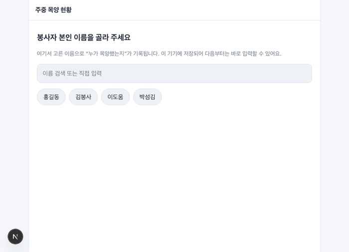
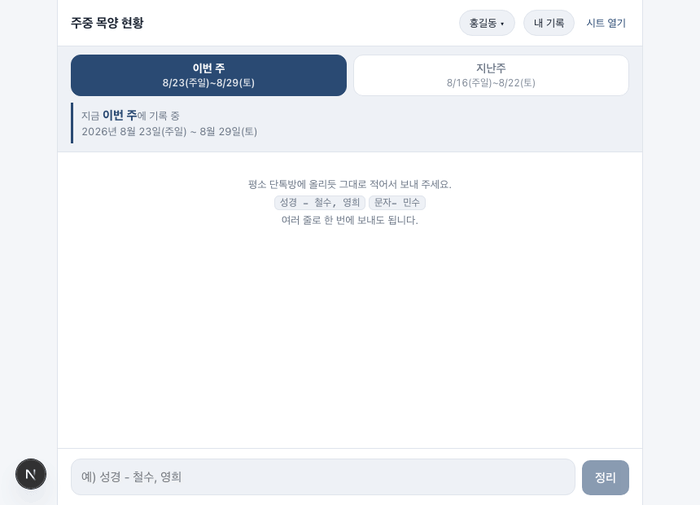
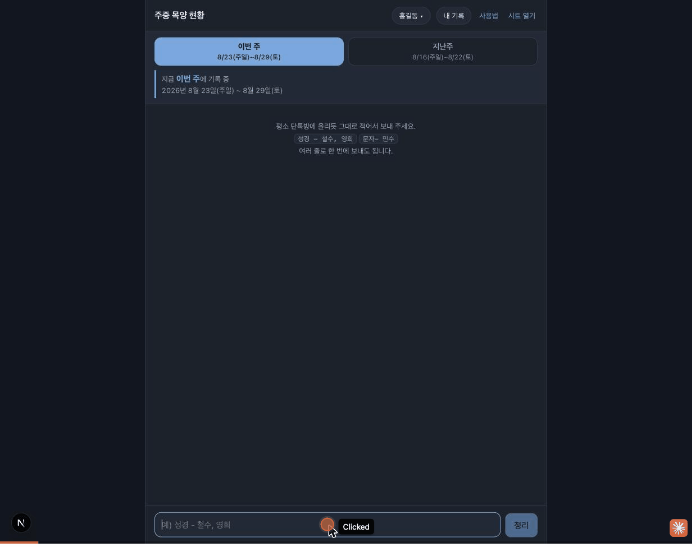
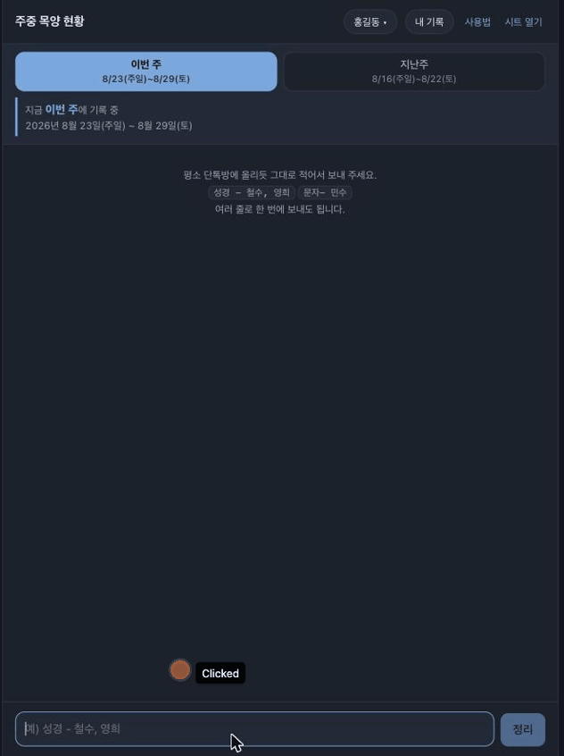

# 사용법

화면 예시는 GIF에 나온 것처럼 가짜 이름(홍길동, 철수, 영희)으로 찍었습니다. 실제 앱에는 우리 봉사자·학생 명단이 나옵니다.

## 1. 본인 이름 고르기

처음 들어오면 봉사자 명단에서 본인 이름을 고릅니다. 한 번 고르면 이 기기에 저장되어 다음부터는 바로 채팅창이 뜹니다.



## 2. 단톡방에 올리듯 그대로 적어 보내기

평소 단톡방에 올리던 문장을 그대로 적으면 됩니다.

```
성경 - 철수, 영희
문자 - 민수
```

보내면 이름별로 정리된 확인 화면이 뜹니다. 이름이 애매하거나 처음 보는 이름이면 화면에서 바로 골라 확정할 수 있습니다. 다 맞으면 **저장** 버튼을 눌러 그 주차 기록에 반영합니다.



## 3. 명단에 없는 이름 추가하기

명단에 없는 이름을 적으면 &ldquo;새 학생&rdquo;으로 표시됩니다. 성·이름·그룹·학년을 채우면 저장할 때 학생명단에도 같이 추가됩니다.



## 4. 항목 잘못 적었을 때 바꾸기

확인 화면에서 이름 앞의 항목(성경·문자·통화·만남)을 눌러 바로 바꿀 수 있습니다.


## 5. 내 기록 확인하기

**내 기록** 버튼을 누르면 본인이 그 주에 적은 내용을 다시 볼 수 있습니다.



## 6. 내 기록 지우기

**내 기록** 화면에서 각 줄 오른쪽 **삭제**를 누르면 그 한 건만 지워집니다.


---

더 자세한 규칙(주차 기준, 그룹·학년, 시트 구성)은 [README](../README.md)를 참고하세요.
